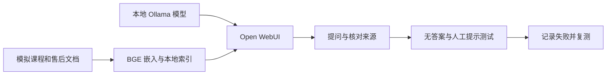

# 本地 AI × RAG × 客服实验室

面向新手的中文动手项目：在自己电脑运行模型，给它一本资料，检查它有没有照着资料回答，再体验模拟业务客服。

作者：孔杰。项目基于本人在 AI 引导下完成的本地实验整理；这是部署与场景配置练习，不是从零开发模型或向量数据库。

## 你会完成什么



完成后，你能亲手演示“资料导入 → 本地检索 → 回答 → 来源核对 → 人工提示”。这里的人工提示只是文字，尚未接入工单或真实坐席。

## 当前交付状态

- 原始 Mac 实验：亲手建库、导入、引用核对、Qwen / DeepSeek 对比已进行，包含失败案例。
- 公开启动器：固定 Open WebUI 0.12.5，独立数据目录，已做静态检查；**尚未完成全新电脑安装验收**。
- Windows / Linux：提供相同 Python 启动入口，尚未实机验证。

目标是降低门槛。目前仍需要安装工具、下载模型和手动建库，不承诺零安装或固定完成时间。

## 开始前准备

推荐先使用有 16 GB 内存的电脑。更小内存设备需选择更小模型并自行验证。首次需要联网下载数 GB 模型、Python 依赖和嵌入模型，准备足够磁盘空间。

1. 安装并打开 [Ollama](https://ollama.com/download)。
2. 按 [uv 官方安装说明](https://docs.astral.sh/uv/getting-started/installation/) 安装 uv，然后重开终端。
3. 下载本仓库 ZIP 并解压，或使用 Git 克隆。在项目目录打开终端。

Mac / Linux：

```bash
uv run --python 3.11 launch.py
```

Windows PowerShell：

```powershell
uv run --python 3.11 launch.py
```

首次会下载默认 Qwen2.5 3B、安装固定版本 Open WebUI，并在首次启动时获取中文 BGE 嵌入模型。等待后打开 **http://127.0.0.1:3016**。首次注册的本地账号用于管理自己的知识库，请勿填入真实工作密码。

启动器使用本机默认 Ollama 端口 11434。已有 Ollama 在其他端口的用户需调整脚本；原始实验使用的自定义端口环境不会被这个启动器自动接管。

## 手把手跑一遍

1. 在新页面进入“工作空间 → 知识库”，新建“SEO-GEO 课程售后实验”。界面文字可能随翻译改变。
2. 上传 `knowledge/` 中的全部 6 份 Markdown 文件，等待处理完成。不要上传 prompts 或 docs 目录。
3. 在管理员文档设置中核对嵌入模型为 `BAAI/bge-small-zh-v1.5`。已有数据库的配置可能覆盖环境变量；更换嵌入模型后需要重新索引。
4. 新建对话，选择 `qwen2.5:3b`，在输入框输入 `#` 并选择刚建的知识库。
5. 打开右上角对话设置，把 [完整客服提示词](prompts/customer-service.txt) 粘贴进“系统提示词”。新对话需要重新核对是否填入。
6. 问“课程资料能看多久？”，展开来源，检查是否对应模拟交付规则里的“开通后 90 天”。
7. 按 [测试题与参考判据](docs/evaluation.md) 继续测下载、退款和知识问答，记录回答及引用片段。

**成功标准不是每题都对**：能够运行、导入、检索、回答、检查证据并记录失败，即完成第一轮实验。可靠性需要单独评估。

## 对比 DeepSeek

另开终端下载可选模型：

```bash
ollama pull deepseek-r1:8b
```

再在界面切换模型。它是 DeepSeek-R1 的 8B 蒸馏版本，不是完整大模型。使用相同资料、提示词、问法和独立新对话做比较。更大的模型可能更慢，也不保证更准。

## 本地与离线

模型下载后由本机 Ollama 推理；嵌入模型由本机 Open WebUI 运行。索引和上传资料保存在 `.local-data/`。不需要付费模型 API。

首次安装及模型下载需联网。要验证离线，先在联网状态完成导入和一次问答，再断开外网，重复提问并核对引用。原始实验中用户自述已亲自验证断网运行；本仓库的新启动流程尚未单独完成离线验收。关闭网络不等于已经完成隐私审计。

## 商业场景怎么理解

这里模拟课程售后：课程学习答疑、交付说明、资料缺失、退款人工提示。可以将相同流程换成自己有权使用的业务文档。真实订单、退款操作、权限和坐席接入需要额外开发。

## 继续阅读

- [真实实验结果与局限](docs/experiment-results.md)
- [测试题与记录模板](docs/evaluation.md)
- [下载与启动排错](docs/troubleshooting.md)
- [分工、来源与发布范围](docs/provenance.md)

上游：[Open WebUI 快速开始](https://docs.openwebui.com/getting-started/quick-start/) · [Ollama](https://github.com/ollama/ollama) · [中文 BGE](https://huggingface.co/BAAI/bge-small-zh-v1.5)

本仓库自编代码和模拟文档使用 MIT 许可；模型与第三方软件遵循各自许可。
