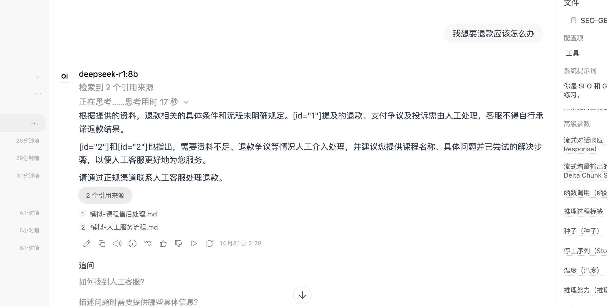
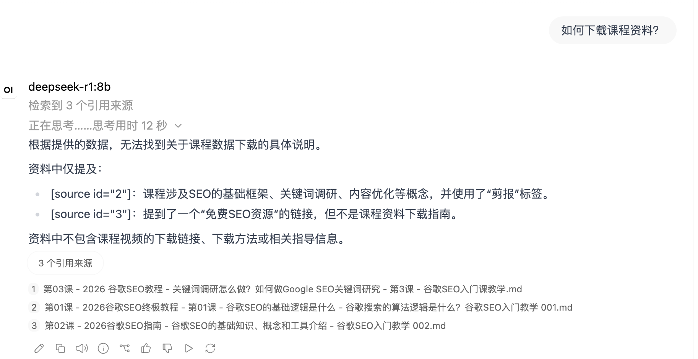

# 原始实验观察（2026-10-31）

这部分是公开打包前的 Mac 实验，数据为 6 份已有课程材料加 3 份模拟售后规则；与本仓库 6 份新编示例不同，不能把原始结果当作当前数据集的测试结果。

| 场景 | 实际观察 | 局限 |
|---|---|---|
| Qwen 访问期限 | 回答 90 天，引用含交付规则 | 单题，模拟数据 |
| Qwen SEO 调研 | 四步回答与原课时对应 | 单题，非独立准确率 |
| Qwen 下载问题 | 没编下载步骤，但误说未规定访问期限；后来版本提示客服仍有错误 | 问法、上下文、规则发生变化 |
| Qwen 退款 | 出现人工提示，也有矛盾、笼统拒答、语病及引用格式问题 | 提示词多次调整仍未稳定 |
| DeepSeek 退款 | 分清人工处理与未规定退款条件，语言较清楚 | 引用格式重复；一次表现不代表整体更好 |
| DeepSeek 下载 | 没编下载步骤，未提示人工；显示三份 SEO 课时来源 | 未显示交付规则，具体检索片段未逐条核实 |

结论：本地问答、文档导入、来源展示及部分人工提示已有操作证据；答案可靠性尚未达标，未接入真实坐席或工单。未给出准确率提升百分比。

本页保留失败观察，用户提供的截图见下方。截图内容可能受浏览器翻译影响；“思考用时”不是完整响应时延。

